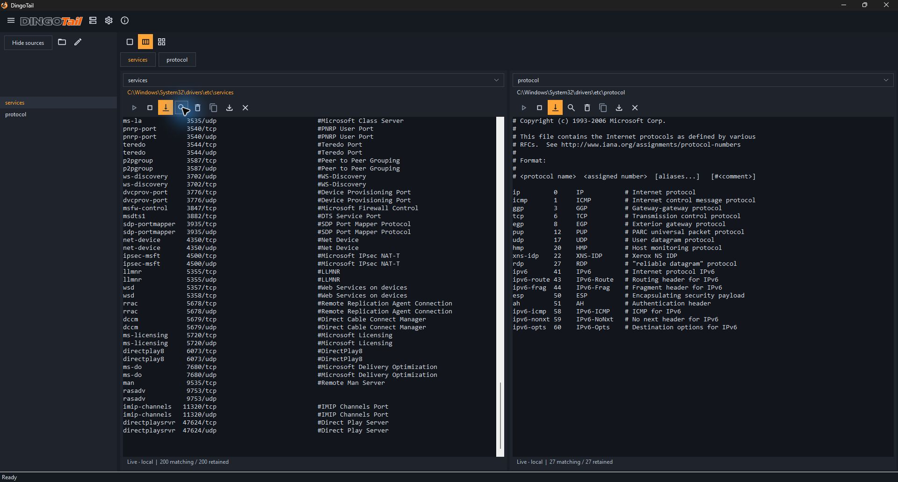
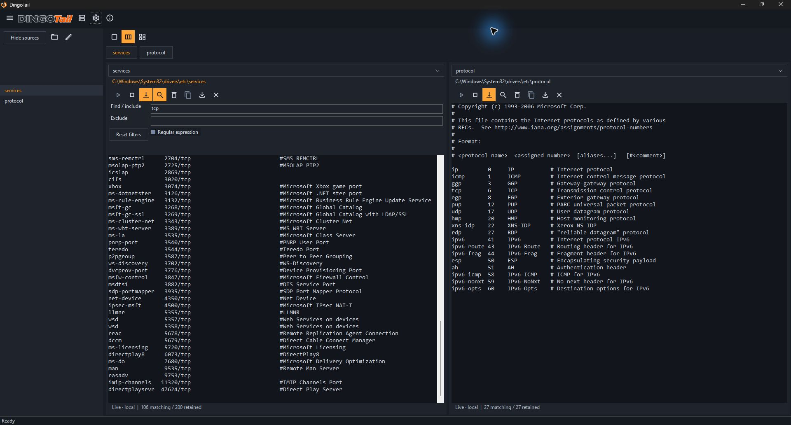
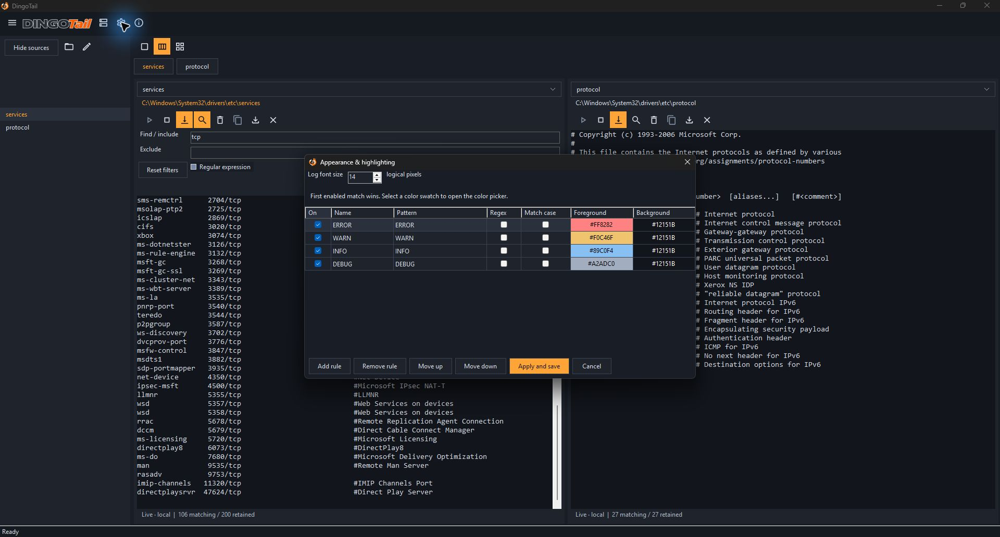

# DingoTail for Windows

<div align="center">
  
  <br />
  
  <br />
  <br />
</div>


DingoTail is a native Windows desktop log viewer for following local text logs, remote files over SSH, and systemd journals. Put related sources side by side, filter each source independently, and highlight the lines you care about.

## Why C# and WinForms?

DingoTail began as a Rust application using egui. This C# and WinForms edition brings its log-viewing workflows to a native Windows interface, with the goal of staying responsive on Windows virtual machines and Remote Desktop sessions where GPU acceleration may be limited or unavailable.

WinForms provides Windows desktop controls, and this edition uses a custom-painted log view to display retained lines. The implementation focuses on local files, SSH sources, systemd journals, multiple panes, filtering, and highlighting within a Windows-focused .NET codebase.

The Rust edition is available in the separate fork, [dingo-tail-rust](https://github.com/jpdevoto/dingo-tail-rust).

## Run the Windows release

1. Open [the Windows x64 build folder](builds/windows-x64/) and download the ZIP for the latest release.
2. Extract the entire ZIP to a folder and run `DingoTail.exe` from that folder. Keep the DLLs and resource folders alongside the executable.

## Follow local and remote sources

Open a local text file with the folder button, or enter its absolute path with the pencil button. Use the layout buttons to switch among one, two, and four panes. Each pane has controls to start and stop reading, resume live follow, copy a selected line, and export matching retained lines.



*Two local readers follow separate files side by side. The status bars show connection state and retained line counts. The screenshots use stock Windows reference files as safe sample text.*

Use the SSH toolbar to configure a server, then browse files over SFTP or add a systemd journal source. Remote file following requires a server with SSH and a compatible `tail -F` command. Journal following requires `journalctl` and access to the requested journal. Optional read-only sudo browsing requires existing passwordless sudo permission to run a supported external OpenSSH `sftp-server -R`. Verify the server's host key fingerprint when prompted.

## Filter and highlight

Use the magnifier or **Ctrl+F** in the active pane to open **Find / include** and **Exclude**. Literal matching is case-insensitive. Enable **Regular expression** to use patterns. Filters apply to the selected source for the current session.



*The left pane shows 106 of 200 retained lines after filtering for `tcp`. The right pane continues to show all 27 of its lines.*

Open **Appearance & highlighting** with the gear button to adjust the log font size and change the order, patterns, or colors of highlighting rules. The first enabled matching rule wins.



*The appearance dialog shows the font size and the default ERROR, WARN, INFO, and DEBUG highlighting rules.*

## Build from source

Use Windows with the .NET 8 SDK and access to a NuGet feed that provides the project dependencies. The application uses C#, WinForms, and Tmds.Ssh 0.26.0. The SDK-style project file declares the target framework and package references.

From the repository root in PowerShell:

```powershell
dotnet build .\src\DingoTail\DingoTail.csproj -c Release
dotnet run --project .\src\DingoTail\DingoTail.csproj -c Release
```

To publish a self-contained Windows x64 build:

```powershell
dotnet publish .\src\DingoTail\DingoTail.csproj -c Release -r win-x64 --self-contained true
```

The default workspace file is `%APPDATA%\DingoTail.WinForms\workspace.json`. It stores workspace settings, source locations, SSH profiles, and host trust. Passwords and passphrases are kept out of the saved workspace.

## Directory layout

| Path | Contents |
| --- | --- |
| `src/DingoTail/` | WinForms project, application source, and icon outlines |
| `assets/` | Application icon, mascot, wordmark, and Material Icons font |
| `docs/screenshots/` | Captures of the existing release running on the Windows QA desktop |
| `builds/windows-x64/` | Self-contained release ZIP and SHA-256 checksum |
| `licenses/` | Embedded branding and Material Icons notices, plus third-party dependency notices |

## License and notices

The code is licensed under GPL-3.0-only. Branding and the Material Icons have separate terms. The branding notice also describes artwork paths from the earlier Rust project. The WinForms project file identifies the artwork used by this edition. [License](LICENSE) · [Copyright](COPYRIGHT) · [Branding terms](BRANDING.md) · [Material Icons license](Material-Icons-LICENSE.txt) · [Third-party notices](licenses/DEPENDENCIES.txt)
